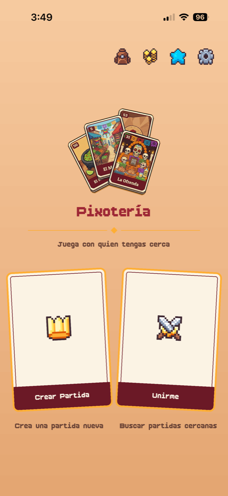
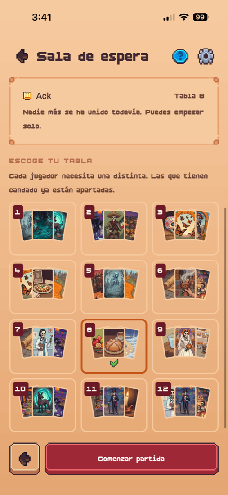
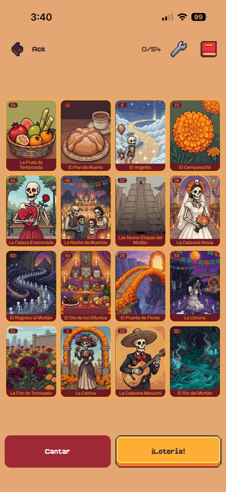
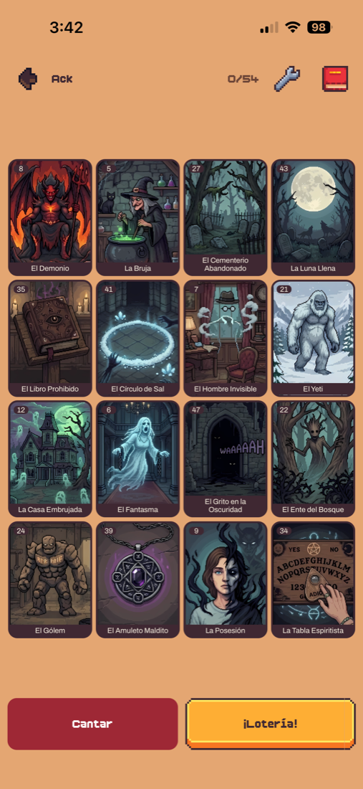
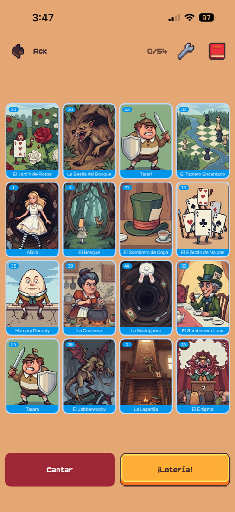
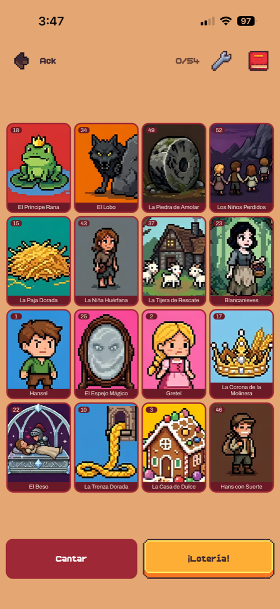
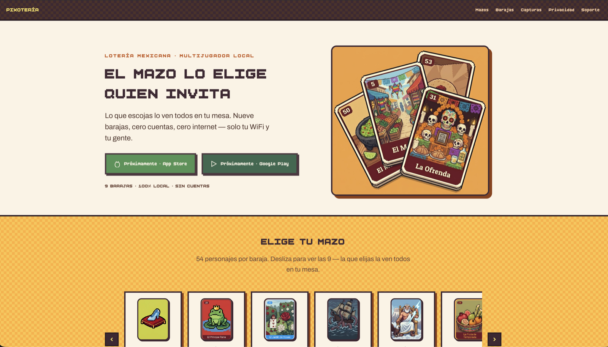
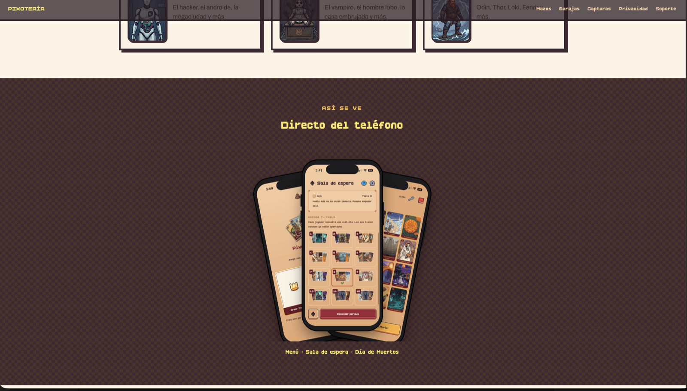

# 🎴 Pixotería — Multiplayer Mexican lottery game for iOS & Android

🌐 **English** · [Español](README_es.md)

A Mexican *lotería* you play like at the table: several people, each on their own phone, on the same WiFi. One phone creates the game, the others find it automatically and join. **No accounts, no internet, no servers.**

  
  
  

---

## 🎯 About the project

I wanted a lotería that plays like the real thing, which poses three problems at once:

1. Phones must **find each other** on the network by themselves.
2. The game must stay **in sync** without a cloud refereeing it.
3. It must look and sound like lotería, with **its own identity**, not a template.

> **Period:** Aug – Oct 2026 · **Platforms:** iOS and Android (single codebase) · designed, built, illustrated and prepared for store release end to end.

## ✨ Features

| | |
|---|---|
| 🧑‍🤝‍🧑 **Local multiplayer** | Host creates the game, players appear in the waiting room on their own |
| 🃏 **9 decks × 54 cards** | Traditional, Day of the Dead, Horror, Perrault, Grimm, Carroll, Pirates, Greek, Cyberpunk, Norse — 486 illustrated cards with their own pixel art |
| 🏆 **3 winning patterns** | Full board, line, corners |
| 🔊 **Voice** | The app calls the cards out loud |
| 🌍 **ES / EN** and accessible font scale | |
| 🔒 **Private by design** | Zero accounts, ads or data collected in release 1 |

## 🖼️ Gallery

  
  
  

## 🛠️ Tech stack

| Technology | Role |
|---|---|
| Expo / React Native (TypeScript) | Cross-platform app |
| expo-router | Navigation |
| Zustand | State |
| i18next | ES / EN translations (no loose strings) |
| TCP over local network + mDNS/Bonjour | Multiplayer and automatic discovery |
| Astro · Cloudflare | Static launch website |

## 🧠 Key technical decisions

### Architecture decided before writing code
I documented decisions and discarded options in a `plan.md` from day one.

- **Local WiFi + TCP instead of Bluetooth.** BLE is built to connect an accessory, not to sync state between 3–4 equal devices. I ruled it out after researching it, with a comparison table of three options (local WiFi, BLE, WiFi Direct/Multipeer).
- **Authoritative host:** the host owns the deck, history and boards; clients only render. Simpler and avoids discrepancies, at the cost that if the host drops the game ends — written down as an accepted limitation.
- **Biggest risk identified early:** client isolation on some WiFi networks, so **Phase 0 was a proof of concept** to validate the riskiest thing first.

### The network, up close
- **Automatic discovery with mDNS/Bonjour:** the host announces the game, clients see it in a list.
- **Own protocol over TCP** with message framing, versioning and size/time limits.
- **Separation of concerns:** the socket layer knows nothing about the game and the host logic knows nothing about sockets — which allows testing the table with fake connections.
- **Host defences** against whatever arrives on the socket: input validation, capacity, rejections.
- **Race condition on "¡lotería!"** when two players claim at once: the host decides the order.
- **Real bug found on device:** `expo-network` can return a wrong IP on iOS.

### A game with its own identity
- **Design system with tokens:** no hand-written colours, spacing or fonts; three themes and an accessible font scale.
- **Identity shift:** redesign to custom pixel art after trying third-party art packs.
- **UI kit** with 9-slice frames, scaling and palette, plus a guide to the two render bugs that cost me the most time, so I don't repeat them.

### Quality
Automated tests for the protocol, the table, winning patterns, the catalog and store access. What can be verified without two phones runs in CI; the rest is tested on real devices. Architecture rules are written down (which folder may depend on which).

### Getting to the stores without being rejected
Release in three phases — basic → ads → purchases — so each phase adds a single declaration to Apple and Google instead of defending three on the first review. Release 1: three free decks, no ads, no purchases, no data collected: every privacy-form box says "no" and it's true. I removed the ad libraries instead of switching them off and blocked three Android permissions no feature used. Public privacy policy in Spanish and English.

## 🌐 Launch website

Static **Astro** site on **Cloudflare**, with a custom pixel typeface and no UI framework: deck gallery, real screenshots, privacy policy and support.

  
  

## 🌱 What I learned / what I'd improve

- Validating the biggest risk first saves weeks; documenting why something was discarded is worth as much as documenting what was done; store release is a project inside the project.
- Pending: host migration and automatic reconnection (today, if the host drops, the game ends), connection without shared WiFi (Multipeer / WiFi Direct), and releases 2 and 3 (ads and deck purchases).

## 📄 Note

This repository contains **documentation only**; the source code is private. Happy to walk through it in an interview.

## 📬 Contact

**Infinity dev by Frank** · [GitHub](https://github.com/InfinityByFrank) · [Infinity](https://infinitydev.agency) · [Portfolio](https://portfolio.infinitydev.agency)
